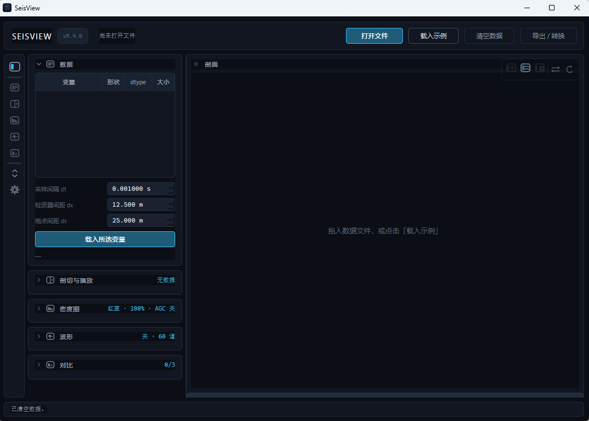
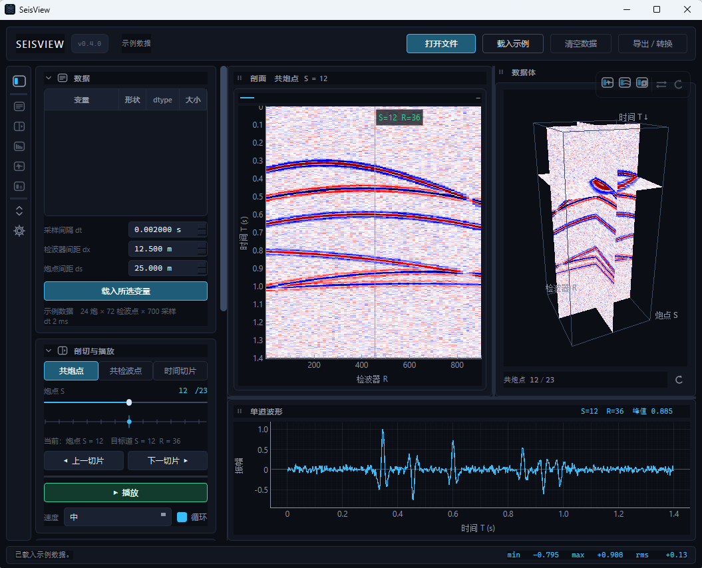
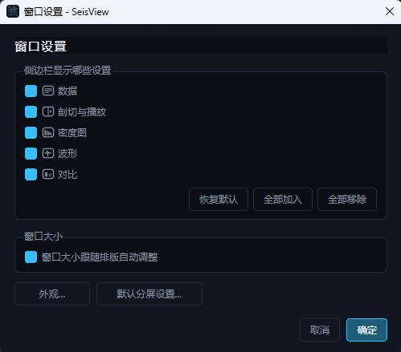
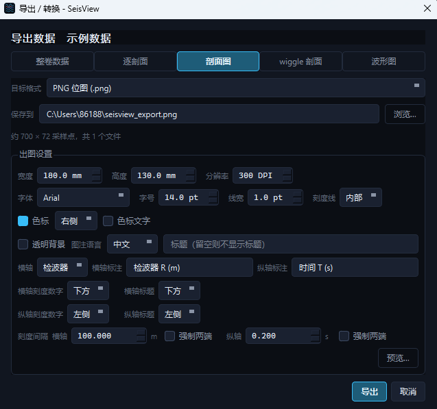

# SeisView

[中文](README.md) | English

SeisView is a desktop visualization and conversion tool for seismic data. It provides linked 3D volume, 2D slice and single-trace waveform views, multi-dataset comparison, and export of publication-ready figures and data files.





---

## Features

- **Data loading**: reads `.npy`, `.npz`, `.mat`, `.sgy` / `.segy` and `.su` files. Files can be dragged into the window or opened from the command line.
- **Linked views**: the 3D volume, common-shot slice, common-receiver slice, time slice and single-trace waveform stay linked. Selecting a face on the volume or a trace on a slice keeps the slice position and target trace consistent across views.
- **Multi-dataset comparison**: displays up to three datasets of the same shape side by side, with synchronized slices and target traces. All panels share one color-scale window, and overlaid curves are colored by dataset order.
- **Display controls**: density image or wiggle-only rendering, color-scale mode, contrast, AGC and render decimation. Controls that do not apply to the current view are disabled.
- **Sweep browsing**: the playhead or playback moves through slices continuously for inspecting lateral continuity.
- **Workspace layout**: single-view and split-view modes with several preset layouts. Panels can be reordered, torn off into floating windows, or docked back.
- **Export and conversion**: whole volumes, per-slice data, slice figures, wiggle slice figures and waveform figures. Figures are written as PNG / SVG with physical axis units; wiggle and waveform figures support curve styles and a legend toggle.

## Typical use cases

- Inspect data dimensions, axis order, amplitude range and valid traces.
- Compare data before / after processing, different processing results or different display settings.
- Perform basic quality control, such as locating missing traces, dead traces and abnormal amplitudes.
- Produce consistent slice and waveform figures for reports, papers or presentations.

## Quick start

### Windows package

Download `SeisView-*-win64.zip` from [Releases](https://github.com/OoBlackFishoO/SeisView/releases), extract the whole folder, and double-click `SeisView.exe`. Python is not required.

> The release is an onedir package. Keep the complete directory together; copying only the exe will not work.

### Run from source

```bash
pip install -r requirements.txt
python main.py
```

A file path can also be passed directly:

```bash
python main.py D:\data\volume.npz
```

Click **载入示例** to view the built-in synthetic data. Running `python make_sample.py` generates additional sample files.

## Supported formats

| Format | Notes |
| --- | --- |
| `.npy` | NumPy array |
| `.npz` | NumPy multi-variable container; choose a variable |
| `.mat` | MATLAB v4 / v5 / v7; v7.3 (HDF5) is not supported |
| `.sgy` / `.segy` | Standard SEG-Y |
| `.su` | Seismic Unix, no file header |

When a `.npy` / `.npz` / `.mat` file is opened for the first time, SeisView asks for the physical meaning of each axis (shot, receiver, time) and remembers the setting per file.


### SEG-Y / SU notes

- The shot, receiver and time dimensions are taken from `FieldRecord`, the in-shot `TraceNumber` order and the samples.
- When sources and receivers are at different positions, the receiver axis represents the in-shot trace number, and a time slice is a shot/trace index plane.
- Missing traces are located by trace number and left empty; the load summary reports them.
- Large files are read on demand; the complete dataset is not loaded into memory when the file is opened.

## Interface and controls

| Area | Operation |
| --- | --- |
| Top bar | Open file, load sample, export / convert |
| Left settings | Select variable, set sampling interval and trace spacing, switch slice direction, adjust display and comparison settings |
| 3D panel | Drag to rotate, wheel to zoom; click a face to switch to that slice |
| Slice panel | Left-drag to pan, wheel to zoom, double-click to reset; click to select the target trace |
| Waveform panel | Shows the current trace; overlays multiple datasets in comparison mode |
| Panel header | Drag to move or tear off; the slice group header moves all panels, while the inner `⇄` grip only swaps dataset order |



## Export and conversion

The top-bar **Export / Convert** button (`Ctrl+E`) provides the following content types:

| Content | Formats | Notes |
| --- | --- | --- |
| Whole volume | `.npy` / `.npz` / `.mat` / SEG-Y / SU | All samples, shaped shot × receiver × time |
| Per-slice | `.npy` / `.npz` / `.mat` | One file per slice along a selected direction; optional slice range |
| Slice figure | PNG / SVG | White background, four-sided axes and a color bar |
| Wiggle slice figure | PNG / SVG | Wiggle-only figure; all compared datasets overlaid |
| Waveform figure | PNG / SVG | Current trace; all compared datasets included |

Matrix exports contain only the data, without sampling metadata; missing traces are filled with 0. Figures are redrawn from the full-resolution slice or trace data (independent of on-screen decimation) and use the current color scale, contrast and AGC settings; they do not include the UI theme or window decoration.

### Publication figure settings

Figure export provides the following settings:

- Physical size (mm) and resolution (DPI); defaults are 180 × 130 mm at 300 DPI.
- Font, font size (14 pt by default) and line width (1 pt by default, adjustable in 0.1 pt steps).
- Four-sided axes; ticks can point inward or outward; only major ticks are shown; tick numbers and axis titles can be placed on the top / bottom and left / right sides independently.
- Separate major tick intervals for the horizontal and vertical axes: seconds for the time axis, meters for the distance axis, amplitude for the waveform axis; `0` means automatic. The first and last tick values can be forced on either axis.
- Figure text in Chinese or English; axis titles can be customized or hidden; no title is added when the title field is empty.
- Color bar on the right or bottom, with optional labels; transparent background.
- For common-shot slices, the horizontal axis can show receiver positions or offset.
- Wiggle and waveform figures support per-dataset curve colors and line styles, with a legend that can be shown or hidden.
- The waveform figure can export a selected time range, adjustable in 0.1 s steps.
- The export preview supports wheel zoom and drag-to-pan.



## Build the Windows application

Run `build.bat`; the output is:

```text
dist\SeisView\SeisView.exe
```

## Requirements

- Python 3.10+
- PySide6, pyqtgraph, PyOpenGL, numpy, scipy, segyio
- OpenGL 4.x for the 3D view (if unavailable, slice and waveform views still work and a message is shown in the right panel)

## Changelog

### v0.4.0

- **Publication figures**: added four-sided axes, inward / outward ticks, movable tick numbers and axis titles, Chinese / English figure text, custom or hidden axis titles, optional title, color-bar position and label switches, and transparent background. The color bar can be placed on the right or bottom, and a bottom bar preserves the slice plot's aspect ratio. Common-shot slices can use an offset axis. Added a separate wiggle slice figure export. Wiggle and waveform figures support per-dataset curve colors and line styles, with a show / hide legend option.
- **Figure parameters**: output by physical size and DPI; default font 14 pt and line width 1 pt, adjustable in 0.1 pt steps; separate major tick intervals for the horizontal and vertical axes, with an option to force the first and last tick values; larger spacing between tick numbers and tick marks, with end ticks fully visible; waveform export time range adjustable in 0.1 s steps; export preview with zoom and pan.
- **Color scale**: automatic mode now uses a P99 floor, with P95 / P98 / P99 / manual options. Exported figures use the same color scale, contrast and AGC settings as the on-screen view.
- **Export workflow**: the settings area scrolls on small screens; default output names do not collide with the current data source, and the source file is protected from accidental overwrite; a file suffix that does not match the selected format is rejected; multi-figure exports can be cancelled, keeping files already written.
- **Robustness**: NaN / Inf no longer affect the color scale, waveform peak or export bounds; zero-length dimensions are rejected; damaged `.npy` / `.npz` / `.mat` files produce a clear message; replacing a dataset in comparison mode requires the same shape, and a failed comparison import restores the previous data source panel.
- **Large files and caching**: reopening large `.mat` and SEG-Y / SU files reuses already-read data, and memory is released when data is cleared; a wait cursor and status message are shown while large files are opened, scanned or read.
- **Interaction**: dragging the reference line on a slice also updates the corresponding 3D slice (time slices stay fixed); the sidebar toggle now collapses all groups when any group is expanded.
- **Interface**: cleaned up redundant interface text by removing repeated descriptions and extra hints, making the settings area and export dialogs more compact.
- **Fixes**: fixed missing components that prevented PNG / SVG export in the packaged release; fixed end tick labels in exported figures being clipped or misaligned with their tick marks.
- **Dependencies**: `pyqtgraph ≥ 0.14`, `segyio ≥ 1.9.14`.

### v0.3.1

- 2D slices and 3D face textures use the same AGC, decimation and color-scale settings; time slices never apply AGC; comparison panels share one color-scale window.
- Slice reset only changes the view and no longer changes the selected trace.
- The slice area moves as one group; a single slice inside the group only swaps dataset order and can no longer be torn off alone; panels keep their normal width in comparison mode.
- Fixed stale images after clearing comparison data, panel resizing on hover, and window resizing when reordering by drag.
- Settings groups keep their scroll position when toggled; leaving a slice shows `—`; the on-screen legend is now a compact header legend.
- Collapsing the sidebar resizes the window by the same amount; changing layouts in fullscreen / maximized mode no longer exits it; restoring returns to the previous window size; tearing off a panel exits fullscreen.
- `.mat` / `.npz` serialization shows progress text.
- Contrast range extended to 10%–1000%.
- New Rose and Frosted Grey themes; new splash screen and faster startup; faster SEG-Y / SU file opening.

### v0.3.0

- Added multi-dataset comparison for up to three datasets of the same shape, with synchronized slices and target traces, and colors following dataset order.
- The waveform panel now uses time on the horizontal axis and amplitude on the vertical axis, with overlaid datasets in comparison mode.
- Added wiggle-only display, drag-and-drop import and import-intent confirmation.
- Export / conversion unified into whole volume, per-slice, slice figure and waveform figure; per-slice export supports slice ranges.
- 2D data automatically hides the 3D panel.
- Workspace changed to single-view / split-view modes with several preset layouts; panels can be torn off and docked back.
- Left settings now use an icon rail with configurable groups; window settings manage groups, themes, window sizing and split layouts.
- Added multiple interface themes and window sizing that follows the layout.

### v0.2.0

- Added export / format conversion for matrices and SEG-Y / SU, with confirmation before writing.
- Added per-slice export.
- Higher contrast values now produce a harder image.
- Display settings grouped by function; inapplicable controls are disabled.
- Slice interaction changed to left-drag pan, wheel zoom and double-click reset.
- NaN / Inf no longer break the color scale.
- Fixed wheel changes on controls and export dialogs that did not shrink back.

### v0.1.0

- First release: linked 3D volume / slice / waveform views, three orthogonal faces, sweep playback, color scale and AGC, wiggle overlay, `npy` / `npz` / `mat` / `sgy` / `su` readers, onedir packaging.

## License

[MIT](LICENSE)
