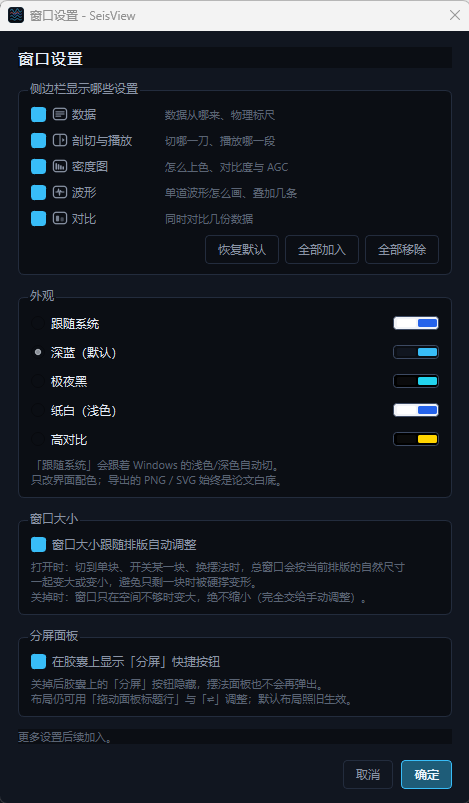

# SeisView

[English](README.en.md) | 中文

一个轻量的地震数据可视化工具：**三维数据体 + 剖面 + 单道波形**三视图联动（可自由分屏、可拉出为独立窗口），支持**多数据对比**，用来快速看一眼 `.npy` / `.npz` / `.mat` / `.sgy` / `.su` 里到底存了什么。


---

## 功能

- **三层下钻**：右侧三维数据体给整体印象 → 在三维上点一个面切到二维剖面 → 在剖面上点一条道看单道波形（**在剖面上点一下就能换到那一道**）。
- **单道波形**：横轴＝时间、纵轴＝振幅；对比模式下同一道号的多份数据用**不同颜色的曲线叠加**；目标道号可在「波形」分组里统一调整（改一处即改全部）。
- **多数据对比**：最多同时载入 **3 份**同形状数据，剖面区按份数分配独立面板；「对比」分组里的**同步开关**把当前数据的切面与目标道号一次性广播给其余数据；剖面上叠加的波形与单道曲线按**从左到右的数据顺序**配色（拖 A 到 B 换顺序会连带改配色）。三块面板**共用同一套色标窗口**（中值 ± 半宽），因此可以直接比较“哪份振幅更强”；屏上的曲线识别色改成标题行里的**紧凑图例**（导出的论文图仍带完整图例）。
- **三种正交面**：共炮点剖面、共检波点剖面、时间切片，随时切换，三维相机自动转到正视该面的方位（带过渡动画）。
- **扫掠播放**：拖动播放头或点播放，连续翻切片，看同相轴的横向连续性。
- **显示模式**：剖面可在**密度图**与**仅 wiggle 曲线**之间一键切换；色标（9 种，含地震惯用的红蓝）、色标上限（自动 / 稳健 / 手动）、对比度、AGC 自动增益（整道或滑动窗口）、渲染抽稀。当前设置下不生效的控件会置灰；**时间切片没有时间轴，AGC 自动置灰且不施加**。
- **可自由排列的工作区**：三块面板装在同一棵 splitter 树里，**单视图 / 分屏**两档一键切换，共**七种具体构图**（含"单道在上""三维在左"）；可把面板拖到工作区任一侧并按 1/3 占位预览，也能把面板**拉出为独立窗口**、拖回即收回；摆法面板里给任意一张点 ★ 即可设为**默认布局**。
- **坏点不捣乱**：数据里的 NaN / Inf 不计入色标与统计读数，显示成面板底色的「洞」，一眼能看出「这里没有数据」。
- **导入**：打开文件（`Ctrl+O`），或**直接把文件拖进窗口**；拖入时按数据形状给出"对比 / 替换"的选择，重复路径与不支持的类型都会有明确交代。
- **导出 / 转换**：可选**整卷数据 / 逐剖面 / 当前剖面图 / 当前波形图**四类内容。整卷与逐剖面写矩阵（`.npy` / `.npz` / `.mat`）或**合成道头**写成 SEG-Y / SU；逐剖面支持**片层范围选择**与「只导出当前显示的剖面」；图片导出为 **PNG / SVG**，是**论文用图**（纯白底、坐标轴带物理单位、默认不画网格）。
- **二维数据也能用**：导入二维数据时**三维面板自动关闭**，剖面与单道照常。
- **主题可切换**：深蓝（默认）/ 极夜黑 / 纸白（浅色）/ 高对比 / 玫瑰红 / 磨砂灰（低反差），外加「跟随系统」；导出图固定论文白底，不受主题影响。中文界面，无 matplotlib 依赖（色带自己插值生成）。

## 快速开始

### 方式一：免安装（推荐给不写代码的人）

到 [Releases](https://github.com/OoBlackFishoO/SeisView/releases) 下载 `SeisView-*-win64.zip`，  
**整个文件夹解压**后双击 `SeisView.exe` 即可，不需要安装 Python。

> ⚠️ 是"文件夹模式"打包，必须整个目录一起解压，不能只把 exe 拷出来。

想要桌面图标：右键 `SeisView.exe` → 发送到 → 桌面快捷方式（图标会自动带上）。

### 方式二：从源码运行

```bash
pip install -r requirements.txt
python main.py
```

也可以直接把文件路径当参数传进去：

```bash
python main.py D:\data\volume.npz
```

打开后点 **载入示例** 可以立刻看到效果（程序内置的合成三维体：24 炮 × 72 检波点 × 700 采样，含 4 个倾斜反射层和 2 个绕射点）。

想生成几个真实点的示例文件（`.npz` 多键 / `.npy` / MATLAB 存法的 `.mat`）：

```bash
python make_sample.py      # 输出到 sample_data/
```

## 支持的数据格式

| 格式               | 说明                  | 读取方式                               |
| ---------------- | ------------------- | ---------------------------------- |
| `.npy`           | 裸数组                 | **mmap 惰性读取**，不占常驻内存               |
| `.npz`           | 多变量容器，列出清单供选择       | 只解压被选中的那一个成员                       |
| `.mat`           | MATLAB v4 / v5 / v7 | 整文件载入缓存一次；**不支持 v7.3（HDF5）**，会明确提示 |
| `.sgy` / `.segy` | 标准 SEG-Y            | 扫道头分选，可 mmap 惰性读取                  |
| `.su`            | Seismic Unix（无文件头）  | 同上，自动识别字节序                         |

所有数据在内部统一规范化为 **`(S, R, T)` = (炮点, 检波器, 时间)**，二维数据自动升维成 `(1, R, T)`，因此一维 / 二维 / 三维走的是同一条代码路径。

**关于轴序**：`.npy` / `.npz` / `.mat` 的轴序在全世界都不统一（MATLAB 常存 `时间×道`，Python 常存 `道×时间`），所以首次打开某个文件时会弹一个确认框，让你核对每一维的物理含义，之后按文件指纹记住。真的画错了很难发现，所以这里刻意不自动猜。


## SEG-Y / SU 的两个说明

**① 分选规则是固定的**：`FieldRecord → 炮点 S`、`炮内 TraceNumber 顺序 → 检波器 R`、样点 → 时间 T。

这不是"空间立方体"：炮点和检波点不在同一位置时，**R 轴是炮内道序而不是物理检波点坐标**，时间切片也是 `(炮号, 道号)` 索引平面而不是平面图。载入后左侧会给出摘要说明。  
如果文件里缺道，会**按道号定位、缺失位置留空**（不会把后面的道顶上来造成整炮错位），并在摘要里报告缺了几炮几道。

**② 大文件不预读**：只要各炮道数一致、样点是标准浮点/整型，就会用 `mmap + as_strided` 建一个零拷贝视图——打开 3 GB 的文件只扫一遍道头（几秒），出图是瞬时的，常驻内存几乎不涨。数据是老的 IBM 浮点格式或道数不整齐时，自动退回整块读入，结果一样正确。

> 想量化某份 SEG-Y / SU 的加载耗时：用 `SEISVIEW_PROFILE=1` 启动（源码运行时 `$env:SEISVIEW_PROFILE="1"; python main.py`），控制台会打印「打开 / 扫道头 / 建索引 / 建 mmap 视图或整块读入」各段耗时。道头扫描现在用一次 strided mmap 同时读两个必需字段，异常文件会自动退回 segyio 路径。

### pluto 那样炮检不同位置的数据

上面这套规则照样能看：共炮点面就是标准炮集（横轴道序、纵轴时间），共检波点面在固定排列下是检波点道集。若道头里 `SourceGroupScalar` 等字段规范，程序会把**偏移距范围和道距**写进摘要供核对；拿不到可信间距时，横轴按道序号显示并明确标注，不会编一个假标尺。

## 导出与格式转换

顶栏的「导出 / 转换」按钮（快捷键 `Ctrl+E`）先选**导出什么**，再选格式。四类内容性质差别很大，对话框里都写在明面上：

| 导出内容 | 格式 | 一句话 |
| --- | --- | --- |
| 整卷数据 | `.npy` / `.npz` / `.mat` / SEG-Y / SU | 全部采样，形状固定 `(S, R, T)` |
| 逐剖面 | `.npy` / `.npz` / `.mat` | 沿一个方向切开，每片一个文件；可选片层范围 |
| 当前剖面图 | PNG / SVG | **论文用图**（纯白底 + 物理坐标轴），重画而不是截屏 |
| 当前波形图 | PNG / SVG | 同上，当前单道（对比时含多份数据） |

下面按内容分别说明。

### 写成矩阵（`.npy` / `.npz` / `.mat`）

只导出**数据本身**：形状固定为 `(S, R, T)` = `(炮 × 检波器 × 时间)`。

- 不写 dt / dx / ds 等元信息 —— 下游得自己知道采样间隔；
- 缺道位置以 **0** 填充 —— 因此下游**无法区分**"真 0"和"缺道"；
- 不烘焙任何显示相关的处理（AGC、抽稀、色标都只影响画出来的样子，不影响导出）。

`.npy` 是"先写文件头、再逐炮 memmap 填入"，所以 3 GB 的数据导出时内存里只有一炮；  
`.npz` / `.mat` 的写入库需要一整块连续数组，选这两种格式时对话框会直接提醒，超过约 2.5 GB 会明确拒绝并建议改用 `.npy`。

### 逐剖面导出（每片一个文件）

内容选「**逐剖面**」后，体数据会沿一个方向切开，**每片写成一个独立的二维文件**（901 个共炮点剖面 → 901 个 `.mat`）。此时「保存到」那一栏填的是**文件夹**。

两个范围控件：

- **片层范围**（起始 / 结束）—— 只导出这一段片；旁边有「**把范围设为当前剖面所在的那一片**」一键对齐到当前画面；
- **只导出当前显示的剖面** —— 勾上后忽略上面的范围，直接导出当前剖面面板正在显示的那一片；**对比模式下会一次导出全部数据源**的那一片（对比数据各自的当前片位置由「同步」开关决定，范围控件自动置灰）。

| 剖面方向 | 片数 | 单片形状 | 说明 |
| --- | --- | --- | --- |
| 共炮点剖面（时间*偏移距） | 炮数 | `(时间, 检波器)` | 也就是惯例的 `(nt, nr)` 炮集 |
| 共检波点剖面（时间*炮点） | 道数 | `(时间, 炮点)` | |
| 时间切片（炮点*偏移距） | 采样数 | `(炮点, 检波器)` | |

每片的方向与软件里的剖面窗口**一致**（行 = 纵轴、列 = 横轴），所以导出后拿 MATLAB / NumPy 一画就该和屏幕上看到的一样。文件里的变量名仍然是 `cube`（形状是二维），下游一套代码就能读所有文件。

文件名只有一条规则：**文件名 + 下划线 + 序号 + 扩展名**，序号就是该方向的炮号 / 道号 / 时间采样号（从 0 开始）：

| 填的「文件名」 | 生成的名字（共炮点，`.mat`） |
| --- | --- |
| `demo` | `demo_0.mat`、`demo_1.mat`、… |
| 留空 | `0.mat`、`1.mat`、…、`900.mat` |

序号不补零，所以拿到 `1.mat`、`10.mat` 这种名字时按文件名排序不是数字顺序 —— 要按顺序读就自己按序号拼名字。对话框下方会实时显示前两个文件名和总片数。

中途取消时，**已经写完的文件保留**（它们都是完整可用的），只删掉正在写的那一个，并在提示里告诉你写了多少。

### 写成图片（PNG / SVG）

「当前剖面图」与「当前波形图」导出的是**论文用图**：把当前画面**重新画**成一张图，而不是截屏 —— 所以：

- **纯白底 + 深色坐标轴**，与界面主题无关（界面换成浅色 / 深色都不影响导出图）；
- 坐标轴按设置面板里的 `dt / dx / ds` 换算成**带物理单位的原始数值**（时间 s、空间 m），读者不用自己做乘法；
- 默认**不画网格**（地震剖面里网格只会盖在同相轴上）；
- 剖面色标兼容灰度图与红蓝地震图；只显示 wiggle 时不画网格；
- 图形尺寸 / 采样间隔单位在导出对话框里可调；对比模式下**每份数据的当前剖面各画一张**，文件名带数据序号。

线的样式（黑实线 / 红实线 / 蓝虚线那套论文惯例）由「波形」分组里的**线型**控制 —— 它只喂给导出图，屏上看不到它的效果（屏上走的是"数据识别色"）。

### 写成 SEG-Y / SU

SEG-Y 是"逐道自带道头"的扁平道列表，而立方体只是个抽象网格，所以这里**合成**一套最小但正确的道头：

| 道头字段 | 写入值 |
| --- | --- |
| `FieldRecord` | 炮号 + 1 |
| `TraceNumber` | 炮内道号 + 1 |
| `TRACE_SAMPLE_COUNT` / `TRACE_SAMPLE_INTERVAL` | 每道采样数 / 采样间隔（µs） |
| `SourceX` / `GroupX` / `offset`（勾选「写入坐标道头（按间距推算，非实测坐标，可选）」时才写） | `s·ds` / `s·ds + r·dx` / `r·dx` |

除此之外**不继承源文件的任何道头**（CDP、高程、日期等都不会被带过来）。

三者自洽（`offset == GroupX − SourceX`，道距 = dx，炮距 = ds），所以任何软件都能正确定位与分选，用本程序读回来也能还原出同样的 dt / dx / ds。

**这是按间距推算的规则几何，不是实测坐标**：真实炮检位置没法由两个间距推出来，**暂不支持每炮观测系统排列不同的情况** —— 那种数据不要勾选，只写炮号 / 道号 / 采样数 / 采样间隔，文件里不带几何，比留一套假坐标更诚实。

**为什么一定要写坐标标量**：SEG-Y 的坐标字段是 32 位整数，道距 12.5 m 这种小数直接取整会变成 13 —— 几何就毁了。所以 dx / ds 带小数时会按 `SourceGroupScalar = −10^k` 把坐标放大成整数再写，读者按标量还原即可拿到精确小数。

采样格式固定写 **IEEE float32（格式码 5）**：兼容性最好。老软件只认 IBM 浮点（码 1）的话需要另做转换，这里不做。

> SU 没有文件头，且 `segyio` 只提供读不提供写，所以 SU 是按 `240 字节道头 + 样点` 的定长记录手写出来的（小端）。

### 导出前会确认一次

点「导出」后先弹一个确认框，把这次动作摊开：

```
确认导出
格式：SEG-Y (.sgy)
内容：整卷数据 24 炮 × 72 道 × 700 采样（约 4.6 MB）
保存到：D:\data\demo.sgy
采样间隔：2000 µs
道头：写炮号 / 道号 / 采样参数；附带规则坐标（道距 12.5 m、炮距 25 m）
                              [导出] [取消]
```

逐剖面导出时列的是片数、方向、片层范围、文件夹与文件名示例；图片导出时列的是图幅与"论文用图"的坐标轴口径；写成 SEG-Y / SU 时列采样间隔与道头内容。

- **目标文件已存在**时，正文多一行覆盖警告，按钮变成 `[覆盖] [取消]`；
- **凡是可能覆盖东西的情况**（目标已存在、或逐剖面可能覆盖一整批同名文件），默认按钮都落在 `[取消]` 上 —— 按回车不会误覆盖，要覆盖得专门去点；
- 点 `[取消]` 会退回导出对话框，可以就地改设置。

## 界面速查

左侧是一栏**可折叠的设置分组**，最左边那条**图标轨道**是它的索引：点轨道上的图标就跳到对应分组（哪几组出现在轨道上由齿轮决定）。

| 区域 | 能做什么 |
| --- | --- |
| 顶栏 | 打开文件（`Ctrl+O`）、载入示例、导出 / 转换（`Ctrl+E`）；左侧有版本号小签；**文件也可以直接拖进窗口** |
| 轨道 · 最左 | 点图标跳到对应设置分组并高亮；底部是 ⇕（批量收放）与齿轮（窗口设置） |
| 数据 | 选变量、设 dt / dx / ds（回车即生效）、看文件摘要 |
| 剖切与播放 | 切成共炮点 / 共检波点 / 时间切片；滑杆或播放头定位；`◀ 上一切片 / 下一切片 ▶` 单步；播放 / 暂停、速度、循环 |
| 密度图 | 色标、色标上限、对比度、AGC、渲染抽稀（不生效的控件置灰）；**密度图 / 仅 wiggle** 切换 |
| 波形 | 目标道号（对比时统一调整）、叠加 wiggle 的道数与幅度；**线型**（只作用于导出的 PNG / SVG） |
| 对比 | 数据源下拉、添加 / 移除对比数据、**同步开关** |
| 右上角胶囊 | 单道 / 剖面 / 三维三个**纯开关**；`⇄` 换"可换序那两块"的先后；`分屏` 打开摆法面板（含 ★ 设默认） |
| 工作区 · 剖面 | **左键拖动平移、滚轮缩放、双击复位视野**；点一下换到那一道单道波形 |
| 工作区 · 单道波形 | 当前道号的一维记录（横轴＝时间、纵轴＝振幅）；对比时多份数据叠加不同颜色 |
| 工作区 · 三维 | 拖动旋转、滚轮缩放；点某个面切到该面的剖面模式；底栏有当前面读数与「复位视角」 |
| 工作区 · 面板标题行 | 拖动 = 拉出独立窗口 / 换分屏 / 拖回插回；**剖面组**拖「剖面」标题行的六点，移动的是整组（对比时含全部剖面）；组内单幅剖面的 `⇄` 抓手只交换数据顺序；快捷键 `1/2/3` 独看某一块、`Tab` 循环 |
| 齿轮（轨道底部） | 窗口设置：侧边栏分组 / 外观主题 / 窗口大小是否跟随排版 / 分屏面板 |

鼠标悬停在剖面上时，右上角会实时显示该点的物理坐标；鼠标离开（或移到左下角复位按钮上）后显示 `—`。

### 对比模式回归清单

改动对比模式（同步、换序、配色、色标或清空流程）后，按这张清单回归一遍；自动化测试也覆盖了能无头验证的部分：

- [ ] **同步开**：改主源片号 / 道号 → 其余数据源跟随。
- [ ] **同步关**：改主源 → 其余源不动（可以并排看不同位置）。
- [ ] **3 源换序**：拖 A 到 B → 配色与数据内容一起换，主窗口和各剖面块的像素尺寸不变。
- [ ] **清空后重载**：3 源 →「清空数据」→ 三块都回到空态占位，没有残留图像 / 色标 / 单道曲线；再载入新数据不出现旧数据残影。
- [ ] **浮窗**：把面板拖出为独立窗口后，对比同步与绿线仍然成立。
- [ ] **绿线 / 取道号**：同步开启时三块面板取同一道；滚轮放大后点左下角 `A`（或双击）复位，绿线与道号都不变。
- [ ] **叠加波形**：三份数据的曲线按左右顺序配色，标题行的紧凑图例与曲线颜色对得上。
- [ ] **共享色标**：三块面板使用同一套 `中值 ± 半宽`（状态栏/导出图的色标一致），可以直接比较振幅强弱。
- [ ] **时间切片**：AGC 置灰且不施加；三维时间切片与二维时间切片亮度一致。



### 色标窗口、对比度与播放速度

振幅到颜色的映射由一个**对称窗口**`中值 ± 半宽`决定，两条设置分别管"窗口在哪"和"窗口多宽"：

- **色标上限**（自动 / 稳健 / 手动）定基准窗口：`自动` = `max(8 × 1.4826 × MAD, P95(|x|))`（对重尾数据最多截断 5%，不会把大片样点压成纯色）；`稳健` = 2% / 98% 分位；`手动` = ±填入值。
- **对比度**定窗口相对基准的宽窄：`100%` 就是基准窗口，`200%` 窗口减半（截断更多、画面更「硬」），`50%` 窗口加倍（画面变柔）；始终围绕窗口中点对称缩放。滑杆为**对数刻度**，范围 `10%–1000%`，100% 在正中，往两端每格按比例变化（10% ≈ 放大 10 倍，1000% ≈ 缩到 1/10）。
- 超出窗口的样点只在**显示时**被压成端色（纯红 / 纯蓝 / 纯黑 / 纯白），源数据不动，导出也不受影响。
- **NaN / Inf 不参与统计**：色标与状态栏读数只按有效样点算，坏点显示成面板底色的「洞」。否则一个坏点就会让中位数变成 NaN、整幅图塌成一块纯色。AGC 的能量统计同样跳过坏点，不会把坏点扩散成整条道的空洞。
- 勾上 **AGC** 后振幅先按道归一化，基准窗口改为逐片重算的稳健口径；此时「色标上限」置灰（它不参与计算），对比度仍可继续微调。
- **扫掠播放**四挡的目标间隔是 `150 / 70 / 35 / 16 ms` 每片（≈ `6.7 / 14.3 / 28.6 / 62.5` 片每秒）。实际帧率还会被渲染耗时卡住：几 GB 的 `.sgy` 上选「极快」也快不过画一帧的时间。播放中改挡位**立刻生效**。

## 打包成 exe

双击 **`build.bat`** 就行（会自动检查并安装 PyInstaller、生成图标、打包）：

```
dist\SeisView\SeisView.exe
```

打包配置在 `seisview.spec`：文件夹模式、无控制台黑窗、带图标、**带版本资源**，并排除了 WebEngine/Quick3D 等用不到的上百 MB 组件。

版本号写在两处，**必须一起改**：

- `seisview/__init__.py` 的 `__version__` —— 顶栏那枚版本小签用的就是它；
- `assets/version_info.txt` 的 `filevers` / `prodvers` / `FileVersion` / `ProductVersion` —— 打包时由 `seisview.spec` 的 `version=` 引用，最终落在 exe 的 **Properties → Details**（注意 PyInstaller 的 `version=` 要的是**文件路径**，直接写 `"0.3.1"` 会被当成路径去找文件而报错）。

> 遇到过的坑记录一下：PyInstaller 自带的 `hook-pyqtgraph` 会顺着模块图把 `torch` 一路分析进来，凭空多出 **3.5 GB** 的 CUDA 运行库。已在 `seisview.spec` 里显式排除，打包体积从 3.8 GB 降到 **255 MB**（zip 后约 96 MB）。

## 项目结构

```
seisview/
  volume.py       (S,R,T) 数据契约、三种正交面切片、抽稀、AGC、色标
  loaders.py      文件读取层：npy / npz / mat / sgy / su（惰性 mmap）
  export.py       导出 / 转换：整卷矩阵写出 + 逐剖面（可范围）+ SEG-Y / SU 合成道头
  render.py       色带、数组上色、wiggle 曲线、三维面贴图
  view2d.py       剖面 / 单道面板，以及"论文用图"（白底 PNG / SVG）的离屏绘制
  view3d.py       三维数据体（面贴图 + 射线拾取 + 相机动画）
  widgets.py      自定义控件（胶囊与摆法面板、浮动窗口、折叠卡片、导入意图框、
                  窗口设置、导出对话框、播放头、变量表、轴序确认…）
  main_window.py  装配、信号编排、排版与拖动手势、多数据对比、导入 / 导出
  style.py        调色板化主题（深蓝 / 极夜黑 / 纸白 / 高对比 / 玫瑰红 / 磨砂灰 / 跟随系统）与 QSS
  icons.py        自绘图标（轨道分组、胶囊面板、折叠、抓手、换序…）
  sample.py       内置合成示例数据
tests/            无头回归测试（unittest / pytest 均可收集）
main.py           启动入口
make_sample.py    生成示例数据文件
make_icon.py      生成图标（assets/seisview.ico）
assets/version_info.txt   exe 版本资源（FileVersion / ProductVersion）
seisview.spec     PyInstaller 打包配置
build.bat         一键打包
README.md / README.en.md   中文 / 英文说明
```

## 环境要求

- Python 3.10+
- PySide6、pyqtgraph、PyOpenGL、numpy、scipy、segyio
- 三维视图需要 OpenGL 4.x（不可用时会自动降级：剖面和波形照常能用，右侧给出提示）

## 更新记录

### v0.3.1

- **二维剖面与三维贴图共用同一条 AGC / 抽稀 / 色标链**：同一片、同一参数下两边渲染数组完全一致；时间切片不再施加 AGC（控件同步置灰）；对比模式三块面板共享同一色标窗口。
- **复位只改视野**：剖面左下角 `A` 按钮不再被误判成一次取道；双击复位的第一次单击也会撤销，绿线/道号不会跟着复位乱跑。
- **对比模式修复**：清空数据不再因索引越界中断并残留旧图；悬停不再改变面板宽度；换序只改数据顺序，窗口与各剖面像素尺寸不变。
- **交互细节**：设置分组展开不再跳回顶部；鼠标离开剖面坐标显示 `—`；屏上大图例改为标题行紧凑图例；用户手动调整过的窗口尺寸成为锚点。
- **布局/窗口**：侧边栏收展时窗口等量反向变化；全屏/最大化下切构图不再退出；最大化还原回进全屏前尺寸；拖出面板自动退全屏。
- **导出进度**：`.mat` / `.npz` 序列化阶段显示「正在序列化为 MAT…」并平滑到 99%，不再卡在 90% 无说明。
- **剖面区域改为整组拖动**：六点抓手统一放在「剖面」组标题行（与单道/三维一致）；拖它移动的是对比时的全部剖面，可整组拉出/停靠。组内单幅剖面改用 `⇄` 小抓手，**只交换数据顺序**，不再单独拉出。
- **对比面板悬停不再改变宽度**：右上角坐标读数改成固定提示宽度的省略标签，鼠标指到哪幅剖面都不会再把相邻面板挤窄。
- **剖面比例按每幅计算**：对比时剖面组的自然宽度按“幅数 × 单幅自然宽度”计算，不再把单幅宽度平分给多幅，面板不会因为对比而变成细竖条。
- **对比度扩到 10%–1000%（对数滑杆）**：100% 在正中，往两端按比例变化，既能大幅压硬也能大幅放柔。
- **启动加速**：三维视图与 `scipy.signal` 改为按需加载。没有三维数据时不 import OpenGL，打开软件只需建二维界面；新增轻量启动画面。实测模块导入从约 2.2 s 降到约 0.6 s（源码运行、同机冷启动量级）。
- **SEG-Y/SU 道头扫描加速**：用一次 strided mmap 同时读 `FieldRecord` / `TraceNumber` 与探测字段，替代逐字段扫两遍；变长道等异常自动退回原路径。实测 12 MB / 2880 道文件，扫道头从约 48 ms 降到约 5 ms；`SEISVIEW_PROFILE=1` 启动可在控制台看到「打开 / 扫道头 / 建索引 / 整块读入」四段耗时。
- **新增主题**：玫瑰红、磨砂灰（低反差）。磨砂灰是低饱和、低反差的层次配色，不依赖系统亚克力/背景模糊（Qt 普通控件拿不到真正的背景模糊）。

### v0.3.0

这一版改动量约为上一版的**四倍**（代码 +7900 行左右），把右侧工作区、左侧设置、单道波形、
导入与导出整条链路都改了一遍，并新增**多数据对比**。

- **多数据对比（新）**：最多同时载入 **3 份**同形状数据；剖面区按数据份数分配独立面板，可并排观察；新增「对比」设置分组——数据源下拉 + 「添加对比 / 移除」；**同步开关**把当前数据的切面与目标道号一次性广播给其余数据；剖面上叠加的波形与单道曲线按**从左到右的数据顺序**配色，拖 A 到 B 换顺序会连带改配色。
- **单道波形面板重构**：坐标轴改为**横轴＝时间、纵轴＝振幅**；对比模式下同一道号的多份数据用不同颜色的曲线叠加；「波形」分组可统一调整目标道号（改一处即改全部）；**在剖面上点一下就能换到那一道**。
- **仅显示波形（纯 wiggle）模式（新）**：剖面面板可在"密度图"与"仅 wiggle 曲线"之间一键切换，便于观察同相轴细节。
- **拖放导入（新）**：文件拖进软件窗口即识别并自动导入；按数据形状弹出**导入意图框**——无数据直接载入、形状相同给"对比 / 替换"两个选项、形状不同只给"替换"、最多 3 份对比数据、重复路径给出提示、不支持的类型静默忽略。
- **导出 / 转换扩展**：导出对话框统一承载**整卷 / 逐剖面 / 当前剖面图 / 当前波形图**四类。逐剖面新增**片层范围选择器**（含「把范围设为当前片」）与「**只导出当前显示的剖面**」（对比时含全部数据源），格式含 `.npy` / `.npz` / `.mat` / SEG-Y / SU；图片导出支持 **PNG / SVG**，且是**论文用图**——纯白底、坐标轴按 `dt/dx/ds` 换算成物理单位、默认不画网格、兼容灰度与红蓝地震图（屏上配色与这套无关，屏上走识别色）。
- **二维数据适配（新）**：导入二维数据时**三维面板自动关闭**（只在数据维度变化时自动切换，不覆盖手动选择；换回三维数据会把上次自动收起的那块开回来）。
- **三界面排版系统重做**：三维 / 剖面 / 单道波形三块装进同一棵 splitter 树，分**单视图**与**分屏**两档；右上角悬浮胶囊切换（三个图标是纯开关，「⇄」换先后，「分屏」开摆法面板）；共**七种具体构图**——B 主+侧+底（单道在底栏）、A 左叠右（三维在右列）、BT 单道在上、AL 三维在左，以及 SR / TR / ST 三种两栏；快捷键 `1/2/3` 独看、`Tab` 循环。
- **面板可拉出为独立窗口（新）**：拖标题行即可拉出（无边框 + 自绘描边 + 系统阴影圆角），**尺寸与窗内一致**；拖回工作区边缘自动插回；「复位布局／找回所有面板」作为兜底出口。
- **拖动所见即所得（新）**：拖到工作区某一侧的 **1/3** 内会亮出蓝色感应区并**预先挤占**（插剖面时单道尺寸/位置真的不动），松手丝滑落到目标构图——包括 BT / AL 这两种"预设之外"的镜像；工作区只剩一块时不允许拖走；对比模式下把剖面 A 拖到剖面 B = **交换数据顺序**。
- **默认布局可配置（新）**：摆法面板每张缩略图左上角的 **★** = 把这一张设为默认（三块构图及其先后 + 三种两栏组合各自的先后），另有「恢复内置默认布局」一键清掉自定义；默认在**载入数据 / 清空 / 复位 / 块的显隐变化**时套用（拖动落位不受它影响）。摆法面板本身也能在窗口设置里**关掉**（关掉后胶囊上的「分屏」按钮隐藏，布局仍可用拖动与「⇄」调整）。
- **左侧设置面板重做**：常驻**图标轨道** + 齿轮里勾选"哪几组出现在轨道上"；点图标跳到对应分组并高亮，分组折叠带动画、收起后标题行仍显示当前值摘要。分组按使用链路重排为 数据 / 剖切与播放 / 密度图 / 波形 / 对比。窗口设置对话框统一管：侧边栏分组 / 外观主题 / 窗口大小是否跟随排版 / 分屏面板。
- **主题机制调色板化（重做）**：界面颜色全部抽象成可替换的 token，运行时切换主题（深蓝「默认」/ 极夜黑 / 纸白「浅色」/ 高对比 + 跟随系统）**不重建控件**；换主题会主动重刷自绘图标、画布底色、三维 GL 底色与图例。导出图固定论文白底，不受主题影响。
- **窗口尺寸跟随排版（新）**：换构图 / 开关某一块时总窗口按各块的自然尺寸一起变大或变小（也可在设置里改成"只放大不缩小"）；空间不足时按 **剖面 > 单道 > 三维** 的优先级让位。
- **内部**：新增自绘图标系统 `icons.py`；版本号在顶栏显示为一枚小签，并写进 exe 的版本资源（Properties → Details 可见）。

### v0.2.0

- 新增 **导出 / 格式转换**：矩阵（`.npy` / `.npz` / `.mat`）与 SEG-Y / SU 互转；导出前弹确认框，把格式 / 内容 / 路径 / 道头参数摊开核对，可能覆盖时默认按钮落在「取消」。
- 新增 **逐剖面导出**：沿共炮点 / 共检波点 / 时间方向切开，每片写成一个独立文件，文件名自己定（可留空 → 纯序号）。
- 色标口径「自动」加了 P95 兜底，重尾数据不再"对比度爆表"；对比度改为**数值越大画面越硬**。
- 显示面板用三条横线分成 **上色 / 增益 / 波形叠加 / 性能** 四组；当前设置下不生效的控件自动置灰。
- 剖面交互改为 **左键拖动平移 + 滚轮缩放**（双击复位视野）；改色标 / AGC / wiggle 不再丢失缩放与位置。
- 播放中改速度**立刻生效**；单步切换按钮移到「切片模式」。
- **NaN / Inf 不再毁掉色标**（一个坏点曾会让整幅图塌成一块纯色），现在显示为底色的「洞」，AGC 也不会扩散坏点。
- 界面文案整体精简；对话框不会再有"一直用不到的框"，切换格式后窗口高度自动回收。
- 修复：滚轮误改下拉框 / 滑杆数值、二维数据点不到共炮点面、导出对话框切格式后尺寸不收、开关 AGC 时界面抖动等问题。

### v0.1.0

首个版本：三视图联动（三维数据体 / 剖面 / 单道波形）、三种正交面、扫掠播放、色标与 AGC、wiggle 叠加、`npy` / `npz` / `mat` / `sgy` / `su` 读取、文件夹模式打包。

## 许可

[MIT](LICENSE)
