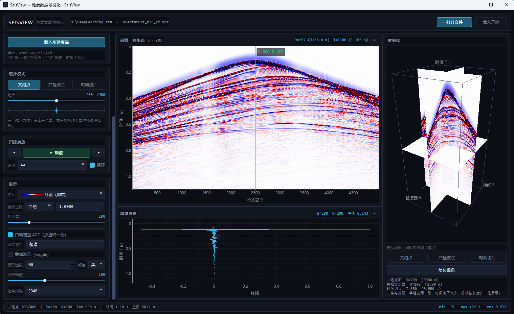

# SeisView

一个轻量的地震数据可视化工具：**三维数据体 + 剖面 + 单道波形**三视图联动，用来快速看一眼 `.npy` / `.npz` / `.mat` / `.sgy` / `.su` 里到底存了什么。




---

## 功能

- **三层下钻**：右侧三维数据体给整体印象 → 在三维上点一个面切到二维剖面 → 在剖面上点一条道看单道波形。
- **三种正交面**：共炮点剖面、共检波点剖面、时间切片，随时切换，三维相机自动转到正视该面的方位（带过渡动画）。
- **扫掠播放**：拖动播放头或点播放，连续翻切片，看同相轴的横向连续性。
- **单道联动**：剖面上有一条绿色提示线，标出下方波形取自**哪一炮哪一道**；收起单道面板时提示线同步隐藏。
- **显示可调**：色标（9 种，含地震惯用的红蓝）、色标口径（自动 / 稳健 / 手动）、对比度、AGC 自动增益（整道或滑动窗口）、叠加波形 wiggle（道数 / 颜色 / 幅度）、渲染抽稀。
- **导出 / 转换**：把当前体数据写成矩阵（`.npy` / `.npz` / `.mat`），或按规则**合成道头**写成 SEG-Y / SU。`.npy` 走流式写出，内存只占一炮。
- **面板可折叠**：剖面和单道两个面板都能一键收起，给另一个腾地方。
- **中文界面、暗色主题**，无 matplotlib 依赖（色带自己插值生成）。

## 快速开始

### 方式一：免安装（推荐给不写代码的人）

到 [Releases](https://github.com/OoBlackFishoO/SeisView/releases) 下载 `SeisView-*-win64.zip`，
**整个文件夹解压**后双击 `SeisView.exe` 即可，不需要安装 Python。

> ⚠️ 是"文件夹模式"打包，必须整个目录一起解压，不能只把 exe 拷出来。

想要桌面图标：右键 `SeisView.exe` → 发送到 → 桌面快捷方式（图标会自动带上）。

### 方式二：从源码运行

```bash
pip install -r requirements.txt
python main.py
```

也可以直接把文件路径当参数传进去：

```bash
python main.py D:\data\volume.npz
```

打开后点 **载入示例** 可以立刻看到效果（程序内置的合成三维体：24 炮 × 72 检波点 × 700 采样，含 4 个倾斜反射层和 2 个绕射点）。

想生成几个真实点的示例文件（`.npz` 多键 / `.npy` / MATLAB 存法的 `.mat`）：

```bash
python make_sample.py      # 输出到 sample_data/
```

## 支持的数据格式

| 格式 | 说明 | 读取方式 |
|---|---|---|
| `.npy` | 裸数组 | **mmap 惰性读取**，不占常驻内存 |
| `.npz` | 多变量容器，列出清单供选择 | 只解压被选中的那一个成员 |
| `.mat` | MATLAB v4 / v5 / v7 | 整文件载入缓存一次；**不支持 v7.3（HDF5）**，会明确提示 |
| `.sgy` / `.segy` | 标准 SEG-Y | 扫道头分选，可 mmap 惰性读取 |
| `.su` | Seismic Unix（无文件头） | 同上，自动识别字节序 |

所有数据在内部统一规范化为 **`(S, R, T)` = (炮点, 检波器, 时间)**，二维数据自动升维成 `(1, R, T)`，因此一维 / 二维 / 三维走的是同一条代码路径。

**关于轴序**：`.npy` / `.npz` / `.mat` 的轴序在全世界都不统一（MATLAB 常存 `时间×道`，Python 常存 `道×时间`），所以首次打开某个文件时会弹一个确认框，让你核对每一维的物理含义，之后按文件指纹记住。真的画错了很难发现，所以这里刻意不自动猜。


## SEG-Y / SU 的两个说明

**① 分选规则是固定的**：`FieldRecord → 炮点 S`、`炮内 TraceNumber 顺序 → 检波器 R`、样点 → 时间 T。

这不是"空间立方体"：炮点和检波点不在同一位置时，**R 轴是炮内道序而不是物理检波点坐标**，时间切片也是 `(炮号, 道号)` 索引平面而不是平面图。载入后左侧会给出摘要说明。
如果文件里缺道，会**按道号定位、缺失位置留空**（不会把后面的道顶上来造成整炮错位），并在摘要里报告缺了几炮几道。

**② 大文件不预读**：只要各炮道数一致、样点是标准浮点/整型，就会用 `mmap + as_strided` 建一个零拷贝视图——打开 3 GB 的文件只扫一遍道头（几秒），出图是瞬时的，常驻内存几乎不涨。数据是老的 IBM 浮点格式或道数不整齐时，自动退回整块读入，结果一样正确。

### pluto 那样炮检不同位置的数据

上面这套规则照样能看：共炮点面就是标准炮集（横轴道序、纵轴时间），共检波点面在固定排列下是检波点道集。若道头里 `SourceGroupScalar` 等字段规范，程序会把**偏移距范围和道距**写进摘要供核对；拿不到可信间距时，横轴按道序号显示并明确标注，不会编一个假标尺。

## 导出与格式转换

顶栏的「导出 / 转换」按钮（快捷键 `Ctrl+E`）可以把当前体数据写成别的格式。**两点性质差别很大，对话框里都写在明面上：**

### 写成矩阵（`.npy` / `.npz` / `.mat`）

只导出**数据本身**：形状固定为 `(S, R, T)` = `(炮 × 检波器 × 时间)`。

- 不写 dt / dx / ds 等元信息 —— 下游得自己知道采样间隔；
- 缺道位置以 **0** 填充 —— 因此下游**无法区分**"真 0"和"缺道"；
- 不烘焙任何显示相关的处理（AGC、抽稀、色标都只影响画出来的样子，不影响导出）。

`.npy` 是"先写文件头、再逐炮 memmap 填入"，所以 3 GB 的数据导出时内存里只有一炮；
`.npz` / `.mat` 的写入库需要一整块连续数组，超过约 2.5 GB 会明确拒绝并建议改用 `.npy`。

### 写成 SEG-Y / SU

SEG-Y 是"逐道自带道头"的扁平道列表，而立方体只是个抽象网格，所以这里**合成**一套最小但正确的道头：

| 道头字段 | 写入值 |
|---|---|
| `FieldRecord` | 炮号 + 1 |
| `TraceNumber` | 炮内道号 + 1 |
| `TRACE_SAMPLE_COUNT` / `TRACE_SAMPLE_INTERVAL` | 每道采样数 / 采样间隔（µs） |
| `SourceX` / `GroupX` / `offset`（可选） | `s·ds` / `s·ds + r·dx` / `r·dx` |

三者自洽（`offset == GroupX − SourceX`，道距 = dx，炮距 = ds），所以任何软件都能正确定位与分选，用本程序读回来也能还原出同样的 dt / dx / ds。

**为什么一定要写坐标标量**：SEG-Y 的坐标字段是 32 位整数，道距 12.5 m 这种小数直接取整会变成 13 —— 几何就毁了。所以 dx / ds 带小数时会按 `SourceGroupScalar = −10^k` 把坐标放大成整数再写，读者按标量还原即可拿到精确小数。

采样格式固定写 **IEEE float32（格式码 5）**：兼容性最好。老软件只认 IBM 浮点（码 1）的话需要另做转换，这里不做。**源文件原有的其它道头字段（CDP、高程、日期等）不会被带过来。**

> SU 没有文件头，且 `segyio` 只提供读不提供写，所以 SU 是按 `240 字节道头 + 样点` 的定长记录手写出来的（小端）。

## 界面速查

| 区域 | 能做什么 |
|---|---|
| 顶栏 | 打开文件（`Ctrl+O`）、载入示例、导出 / 转换（`Ctrl+E`） |
| 左侧 · 数据源 | 选变量、设 dt / dx / ds（回车即生效）、看文件摘要 |
| 左侧 · 切片模式 | 切成共炮点 / 共检波点 / 时间切片；滑杆或播放头定位；`◀ 上一切片 / 下一切片 ▶` 单步 |
| 左侧 · 显示 | 色标、色标口径、对比度、AGC（没勾时窗口框自动置灰）、叠加波形、渲染抽稀 |
| 左侧 · 扫掠播放 | 播放 / 暂停、速度、循环 |
| 中间 · 剖面 | **左键拖动平移、滚轮缩放、双击复位视野**；点一下把该位置传给单道和三维 |
| 中间 · 单道波形 | 显示当前选项位置的一维记录 |
| 右侧 · 数据体 | 拖动旋转、滚轮缩放；点某个面切到该面的剖面模式；三个按钮可定位到面；复位视角 |

鼠标悬停在剖面上时，右上角会实时显示该点的物理坐标。

## 打包成 exe

双击 **`build.bat`** 就行（会自动检查并安装 PyInstaller、生成图标、打包）：

```
dist\SeisView\SeisView.exe
```

打包配置在 `seisview.spec`：文件夹模式、无控制台黑窗、带图标，并排除了 WebEngine/Quick3D 等用不到的上百 MB 组件。

> 遇到过的坑记录一下：PyInstaller 自带的 `hook-pyqtgraph` 会顺着模块图把 `torch` 一路分析进来，凭空多出 **3.5 GB** 的 CUDA 运行库。已在 `seisview.spec` 里显式排除，打包体积从 3.8 GB 降到 **255 MB**（zip 后约 96 MB）。

## 项目结构

```
seisview/
  volume.py       (S,R,T) 数据契约、三种正交面切片、抽稀、AGC、色标
  loaders.py      文件读取层：npy / npz / mat / sgy / su
  export.py       导出 / 转换：矩阵写出 + SEG-Y / SU 合成道头
  render.py       色带、数组上色、wiggle 曲线、三维面贴图
  view2d.py       剖面视图（密度图 + wiggle + 取点）
  view3d.py       三维数据体（面贴图 + 射线拾取 + 相机动画）
  widgets.py      自定义控件（分段按钮、播放头、色带选择、变量表、轴序确认）
  main_window.py  装配、信号编排
  style.py        暗色主题与 QSS
  sample.py       内置合成示例数据
main.py           启动入口
make_sample.py    生成示例数据文件
make_icon.py      生成图标（assets/seisview.ico）
seisview.spec     PyInstaller 打包配置
build.bat         一键打包
```

## 环境要求

- Python 3.10+
- PySide6、pyqtgraph、PyOpenGL、numpy、scipy、segyio
- 三维视图需要 OpenGL 4.x（不可用时会自动降级：剖面和波形照常能用，右侧给出提示）

## 许可

[MIT](LICENSE)
