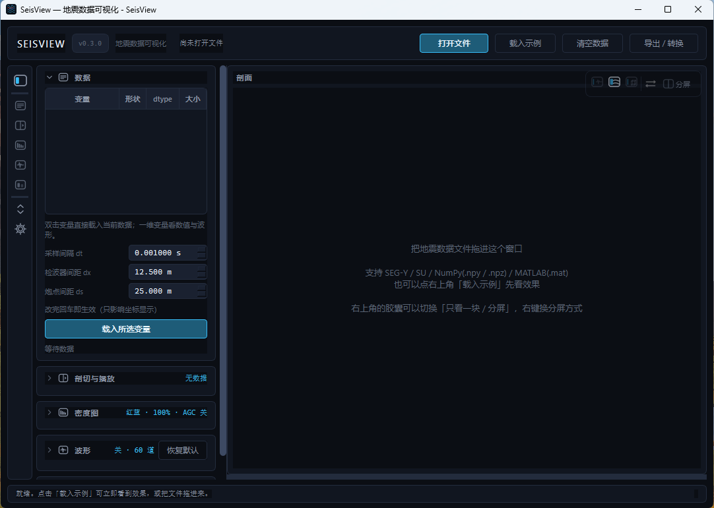
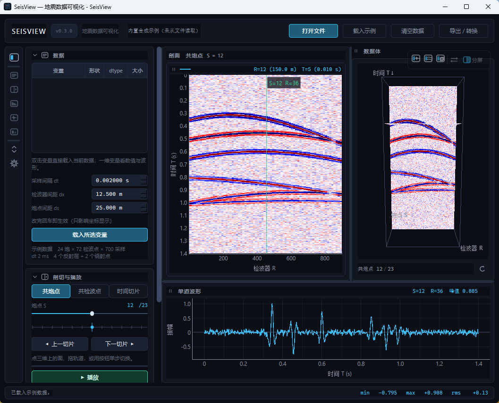
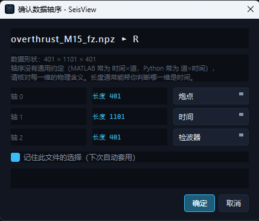

# SeisView

[English](README.en.md) | 中文

SeisView 是一款面向地震数据的桌面可视化工具，提供三维数据体、二维剖面与单道波形的联动浏览、对比分析和图像导出。





---

## 功能介绍

### 软件能做什么

- 载入 `.npy`、`.npz`、`.mat`、`.sgy` / `.segy`、`.su` 数据，统一按炮点、检波器、时间三个维度组织。
- 提供三维数据体、共炮点剖面、共检波点剖面、时间切片和单道波形的联动浏览。
- 支持最多 3 份同形状数据并排对比，并提供同步开关、统一色标和按数据顺序配色。
- 支持导出整卷数据、逐剖面数据、当前剖面图和当前波形图。

### 功能效果

- **三视图联动**：在三维体上选择面可切换到对应剖面；在剖面上选择位置可切换单道波形；切片位置、目标道号和显示参数可在各视图间保持一致。
- **对比分析**：多份数据可并排显示，同步切换切面与目标道；各面板共用同一色标窗口，可直接比较振幅强弱；叠加波形和单道曲线按数据顺序区分颜色。
- **显示调节**：提供密度图与仅 wiggle 曲线两种显示方式，以及色标、色标上限、对比度、AGC、渲染抽稀等参数；时间切片不适用 AGC 时会自动禁用。
- **扫掠浏览**：通过播放头或播放功能连续切换切片，便于观察同相轴的横向连续性。
- **工作区布局**：提供单视图与分屏模式、多种预设构图；面板可拖动换序、拉出为独立窗口或拖回主窗口。
- **图像导出**：可将当前剖面或波形重新绘制为 PNG / SVG，输出为白底、带物理坐标单位的论文用图。

### 适用场景

- 快速检查地震数据的维度、轴序、振幅范围和有效道分布。
- 对比处理前/后的数据、不同算法结果或不同参数下的显示效果。
- 进行简单的数据质控，例如定位缺道、坏道、异常振幅和空道。
- 为报告、论文或汇报制作统一的剖面图和波形图。
- 教学演示中展示三维数据体、正交剖面和单道波形之间的关系。

## 快速开始

### Windows 安装包

从 [Releases](https://github.com/OoBlackFishoO/SeisView/releases) 下载 `SeisView-*-win64.zip`，解压整个文件夹后双击 `SeisView.exe`。无需安装 Python。

> 发布包为文件夹模式，需保留完整目录，不能只复制 exe。

### 从源码运行

```bash
pip install -r requirements.txt
python main.py
```

也可以直接打开指定文件：

```bash
python main.py D:\data\volume.npz
```

启动后可点击「载入示例」查看内置合成数据；执行 `python make_sample.py` 可生成额外的示例文件。

## 支持的数据格式

| 格式 | 说明 |
| --- | --- |
| `.npy` | NumPy 裸数组 |
| `.npz` | NumPy 多变量容器，可选择变量 |
| `.mat` | MATLAB v4 / v5 / v7；不支持 v7.3（HDF5） |
| `.sgy` / `.segy` | 标准 SEG-Y |
| `.su` | Seismic Unix，无文件头 |

首次打开 `.npy` / `.npz` / `.mat` 时，软件会要求确认各维的物理含义（炮点、检波器、时间），并按文件记住该设置。



### SEG-Y / SU 数据说明

- 分选规则固定为：`FieldRecord` → 炮点，炮内 `TraceNumber` 顺序 → 检波器，样点 → 时间。
- 炮点与检波点不在同一位置时，检波器轴表示炮内道序，时间切片表示炮号与道号的索引平面。
- 文件中的缺道按道号定位，缺失位置留空，并在载入摘要中说明。
- 大文件按需读取，打开时无需将完整数据载入内存。

## 界面与操作

| 区域 | 操作 |
| --- | --- |
| 顶栏 | 打开文件、载入示例、导出 / 转换 |
| 左侧设置 | 选择变量、设置采样间隔与道间距、切换切片方向、调节显示参数和对比数据 |
| 三维面板 | 拖动旋转、滚轮缩放；点击某个面切换到对应剖面 |
| 剖面面板 | 左键拖动平移、滚轮缩放、双击复位；点击切换目标道 |
| 波形面板 | 显示当前道的单道记录；对比模式下叠加多份数据 |
| 面板标题行 | 拖动调整位置或拉出独立窗口；剖面组标题移动整组，组内 `⇄` 仅交换数据顺序 |

## 导出与转换

顶栏「导出 / 转换」（快捷键 `Ctrl+E`）支持四类内容：

| 导出内容 | 支持格式 | 说明 |
| --- | --- | --- |
| 整卷数据 | `.npy` / `.npz` / `.mat` / SEG-Y / SU | 导出全部采样，形状为炮点 × 检波器 × 时间 |
| 逐剖面 | `.npy` / `.npz` / `.mat` | 沿一个方向切片，每片写成一个独立文件；支持片层范围 |
| 当前剖面图 | PNG / SVG | 白底、物理坐标轴、带色标的论文用图 |
| 当前波形图 | PNG / SVG | 当前单道波形；对比模式下包含多份数据 |

矩阵导出仅包含数据本身，不写入采样间隔等元信息；缺道位置以 0 填充。导出图片会按当前剖面或波形重新绘制，不包含界面主题和窗口装饰。

## 构建 Windows 程序

运行 `build.bat`，产物位于：

```text
dist\SeisView\SeisView.exe
```

版本号需同时维护 `seisview/__init__.py` 的 `__version__` 和 `assets/version_info.txt` 中的版本资源。

## 项目结构

```
seisview/
  volume.py       (S,R,T) 数据契约、三种正交面切片、抽稀、AGC、色标
  loaders.py      文件读取层：npy / npz / mat / sgy / su（惰性 mmap）
  export.py       导出 / 转换：整卷矩阵写出 + 逐剖面（可范围）+ SEG-Y / SU 合成道头
  render.py       色带、数组上色、wiggle 曲线、三维面贴图
  view2d.py       剖面 / 单道面板，以及"论文用图"（白底 PNG / SVG）的离屏绘制
  view3d.py       三维数据体（面贴图 + 射线拾取 + 相机动画）
  widgets.py      自定义控件（胶囊与摆法面板、浮动窗口、折叠卡片、导入意图框、
                  窗口设置、导出对话框、播放头、变量表、轴序确认…）
  main_window.py  装配、信号编排、排版与拖动手势、多数据对比、导入 / 导出
  style.py        调色板化主题（深蓝 / 极夜黑 / 纸白 / 高对比 / 玫瑰红 / 磨砂灰 / 跟随系统）与 QSS
  icons.py        自绘图标（轨道分组、胶囊面板、折叠、抓手、换序…）
  sample.py       内置合成示例数据
tests/            无头回归测试（unittest / pytest 均可收集）
main.py           启动入口
make_sample.py    生成示例数据文件
make_icon.py      生成图标（assets/seisview.ico）
assets/version_info.txt   exe 版本资源（FileVersion / ProductVersion）
seisview.spec     PyInstaller 打包配置
build.bat         一键打包
README.md / README.en.md   中文 / 英文说明
```

## 环境要求

- Python 3.10+
- PySide6、pyqtgraph、PyOpenGL、numpy、scipy、segyio
- 三维视图需要 OpenGL 4.x（不可用时会自动降级：剖面和波形照常能用，右侧给出提示）

## 更新记录

### v0.3.1

- **二维剖面与三维贴图共用同一条 AGC / 抽稀 / 色标链**：同一片、同一参数下两边渲染数组完全一致；时间切片不再施加 AGC（控件同步置灰）；对比模式三块面板共享同一色标窗口。
- **复位只改视野**：剖面左下角 `A` 按钮不再被误判成一次取道；双击复位的第一次单击也会撤销，绿线/道号不会跟着复位乱跑。
- **对比模式修复**：清空数据不再因索引越界中断并残留旧图；悬停不再改变面板宽度；换序只改数据顺序，窗口与各剖面像素尺寸不变。
- **交互细节**：设置分组展开不再跳回顶部；鼠标离开剖面坐标显示 `—`；屏上大图例改为标题行紧凑图例；用户手动调整过的窗口尺寸成为锚点。
- **布局/窗口**：侧边栏收展时窗口等量反向变化；全屏/最大化下切构图不再退出；最大化还原回进全屏前尺寸；拖出面板自动退全屏。
- **导出进度**：`.mat` / `.npz` 序列化阶段显示「正在序列化为 MAT…」并平滑到 99%，不再卡在 90% 无说明。
- **剖面区域改为整组拖动**：六点抓手统一放在「剖面」组标题行（与单道/三维一致）；拖它移动的是对比时的全部剖面，可整组拉出/停靠。组内单幅剖面改用 `⇄` 小抓手，**只交换数据顺序**，不再单独拉出。
- **对比面板悬停不再改变宽度**：右上角坐标读数改成固定提示宽度的省略标签，鼠标指到哪幅剖面都不会再把相邻面板挤窄。
- **剖面比例按每幅计算**：对比时剖面组的自然宽度按“幅数 × 单幅自然宽度”计算，不再把单幅宽度平分给多幅，面板不会因为对比而变成细竖条。
- **对比度扩到 10%–1000%（对数滑杆）**：100% 在正中，往两端按比例变化，既能大幅压硬也能大幅放柔。
- **启动加速**：三维视图与 `scipy.signal` 改为按需加载。没有三维数据时不 import OpenGL，打开软件只需建二维界面；新增轻量启动画面。实测模块导入从约 2.2 s 降到约 0.6 s（源码运行、同机冷启动量级）。
- **SEG-Y/SU 道头扫描加速**：用一次 strided mmap 同时读 `FieldRecord` / `TraceNumber` 与探测字段，替代逐字段扫两遍；变长道等异常自动退回原路径。实测 12 MB / 2880 道文件，扫道头从约 48 ms 降到约 5 ms；`SEISVIEW_PROFILE=1` 启动可在控制台看到「打开 / 扫道头 / 建索引 / 整块读入」四段耗时。
- **新增主题**：玫瑰红、磨砂灰（低反差）。磨砂灰是低饱和、低反差的层次配色，不依赖系统亚克力/背景模糊（Qt 普通控件拿不到真正的背景模糊）。

### v0.3.0

这一版改动量约为上一版的**四倍**（代码 +7900 行左右），把右侧工作区、左侧设置、单道波形、
导入与导出整条链路都改了一遍，并新增**多数据对比**。

- **多数据对比（新）**：最多同时载入 **3 份**同形状数据；剖面区按数据份数分配独立面板，可并排观察；新增「对比」设置分组——数据源下拉 + 「添加对比 / 移除」；**同步开关**把当前数据的切面与目标道号一次性广播给其余数据；剖面上叠加的波形与单道曲线按**从左到右的数据顺序**配色，拖 A 到 B 换顺序会连带改配色。
- **单道波形面板重构**：坐标轴改为**横轴＝时间、纵轴＝振幅**；对比模式下同一道号的多份数据用不同颜色的曲线叠加；「波形」分组可统一调整目标道号（改一处即改全部）；**在剖面上点一下就能换到那一道**。
- **仅显示波形（纯 wiggle）模式（新）**：剖面面板可在"密度图"与"仅 wiggle 曲线"之间一键切换，便于观察同相轴细节。
- **拖放导入（新）**：文件拖进软件窗口即识别并自动导入；按数据形状弹出**导入意图框**——无数据直接载入、形状相同给"对比 / 替换"两个选项、形状不同只给"替换"、最多 3 份对比数据、重复路径给出提示、不支持的类型静默忽略。
- **导出 / 转换扩展**：导出对话框统一承载**整卷 / 逐剖面 / 当前剖面图 / 当前波形图**四类。逐剖面新增**片层范围选择器**（含「把范围设为当前片」）与「**只导出当前显示的剖面**」（对比时含全部数据源），格式含 `.npy` / `.npz` / `.mat` / SEG-Y / SU；图片导出支持 **PNG / SVG**，且是**论文用图**——纯白底、坐标轴按 `dt/dx/ds` 换算成物理单位、默认不画网格、兼容灰度与红蓝地震图（屏上配色与这套无关，屏上走识别色）。
- **二维数据适配（新）**：导入二维数据时**三维面板自动关闭**（只在数据维度变化时自动切换，不覆盖手动选择；换回三维数据会把上次自动收起的那块开回来）。
- **三界面排版系统重做**：三维 / 剖面 / 单道波形三块装进同一棵 splitter 树，分**单视图**与**分屏**两档；右上角悬浮胶囊切换（三个图标是纯开关，「⇄」换先后，「分屏」开摆法面板）；共**七种具体构图**——B 主+侧+底（单道在底栏）、A 左叠右（三维在右列）、BT 单道在上、AL 三维在左，以及 SR / TR / ST 三种两栏；快捷键 `1/2/3` 独看、`Tab` 循环。
- **面板可拉出为独立窗口（新）**：拖标题行即可拉出（无边框 + 自绘描边 + 系统阴影圆角），**尺寸与窗内一致**；拖回工作区边缘自动插回；「复位布局／找回所有面板」作为兜底出口。
- **拖动所见即所得（新）**：拖到工作区某一侧的 **1/3** 内会亮出蓝色感应区并**预先挤占**（插剖面时单道尺寸/位置真的不动），松手丝滑落到目标构图——包括 BT / AL 这两种"预设之外"的镜像；工作区只剩一块时不允许拖走；对比模式下把剖面 A 拖到剖面 B = **交换数据顺序**。
- **默认布局可配置（新）**：摆法面板每张缩略图左上角的 **★** = 把这一张设为默认（三块构图及其先后 + 三种两栏组合各自的先后），另有「恢复内置默认布局」一键清掉自定义；默认在**载入数据 / 清空 / 复位 / 块的显隐变化**时套用（拖动落位不受它影响）。摆法面板本身也能在窗口设置里**关掉**（关掉后胶囊上的「分屏」按钮隐藏，布局仍可用拖动与「⇄」调整）。
- **左侧设置面板重做**：常驻**图标轨道** + 齿轮里勾选"哪几组出现在轨道上"；点图标跳到对应分组并高亮，分组折叠带动画、收起后标题行仍显示当前值摘要。分组按使用链路重排为 数据 / 剖切与播放 / 密度图 / 波形 / 对比。窗口设置对话框统一管：侧边栏分组 / 外观主题 / 窗口大小是否跟随排版 / 分屏面板。
- **主题机制调色板化（重做）**：界面颜色全部抽象成可替换的 token，运行时切换主题（深蓝「默认」/ 极夜黑 / 纸白「浅色」/ 高对比 + 跟随系统）**不重建控件**；换主题会主动重刷自绘图标、画布底色、三维 GL 底色与图例。导出图固定论文白底，不受主题影响。
- **窗口尺寸跟随排版（新）**：换构图 / 开关某一块时总窗口按各块的自然尺寸一起变大或变小（也可在设置里改成"只放大不缩小"）；空间不足时按 **剖面 > 单道 > 三维** 的优先级让位。
- **内部**：新增自绘图标系统 `icons.py`；版本号在顶栏显示为一枚小签，并写进 exe 的版本资源（Properties → Details 可见）。

### v0.2.0

- 新增 **导出 / 格式转换**：矩阵（`.npy` / `.npz` / `.mat`）与 SEG-Y / SU 互转；导出前弹确认框，把格式 / 内容 / 路径 / 道头参数摊开核对，可能覆盖时默认按钮落在「取消」。
- 新增 **逐剖面导出**：沿共炮点 / 共检波点 / 时间方向切开，每片写成一个独立文件，文件名自己定（可留空 → 纯序号）。
- 色标口径「自动」加了 P95 兜底，重尾数据不再"对比度爆表"；对比度改为**数值越大画面越硬**。
- 显示面板用三条横线分成 **上色 / 增益 / 波形叠加 / 性能** 四组；当前设置下不生效的控件自动置灰。
- 剖面交互改为 **左键拖动平移 + 滚轮缩放**（双击复位视野）；改色标 / AGC / wiggle 不再丢失缩放与位置。
- 播放中改速度**立刻生效**；单步切换按钮移到「切片模式」。
- **NaN / Inf 不再毁掉色标**（一个坏点曾会让整幅图塌成一块纯色），现在显示为底色的「洞」，AGC 也不会扩散坏点。
- 界面文案整体精简；对话框不会再有"一直用不到的框"，切换格式后窗口高度自动回收。
- 修复：滚轮误改下拉框 / 滑杆数值、二维数据点不到共炮点面、导出对话框切格式后尺寸不收、开关 AGC 时界面抖动等问题。

### v0.1.0

首个版本：三视图联动（三维数据体 / 剖面 / 单道波形）、三种正交面、扫掠播放、色标与 AGC、wiggle 叠加、`npy` / `npz` / `mat` / `sgy` / `su` 读取、文件夹模式打包。

## 许可

[MIT](LICENSE)
